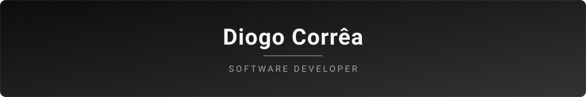

  

  
  
  

---

### Sobre mim

Olá! Sou o **Diogo**, um desenvolvedor de software focado em criar soluções eficientes, limpas e escaláveis. Estou sempre explorando novas tecnologias e aprimorando minhas habilidades para entregar códigos de qualidade.

---

### Tech Stack

  <!-- Linguagens -->
  
  
  
  
  
   

  <!-- Web & Frameworks -->
  
  
  
  
  
  

   

  <!-- Ferramentas & Banco de Dados -->
  
  
  

---

### Ferramentas & Ambiente

  
  
  

---

### Estatísticas

  
  

---

  

